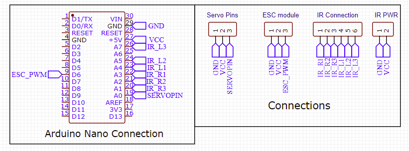
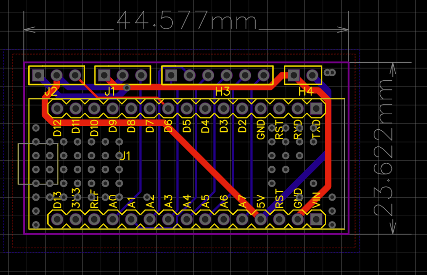
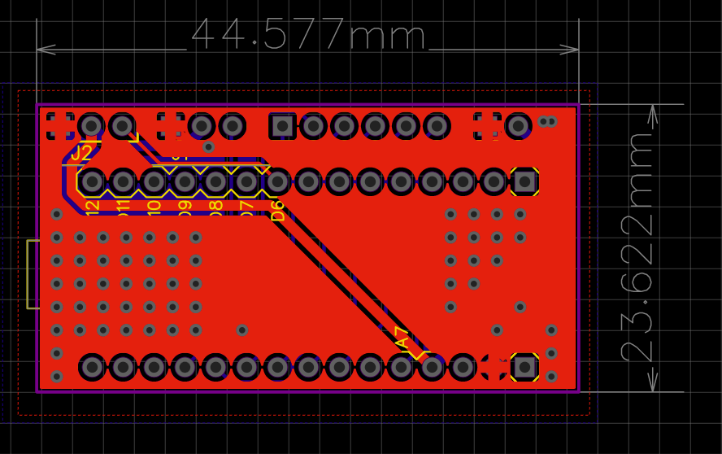
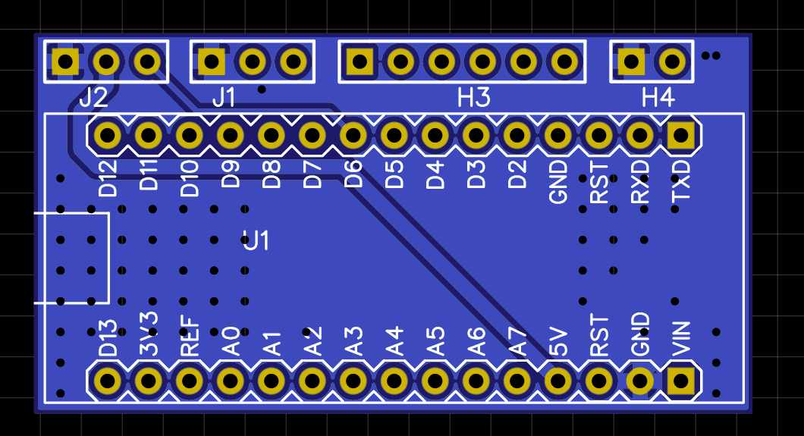
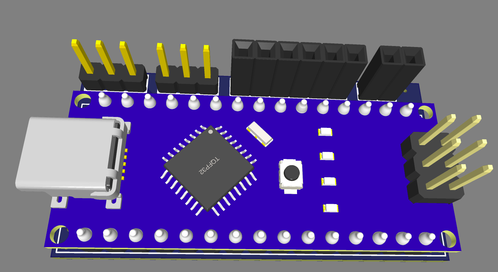
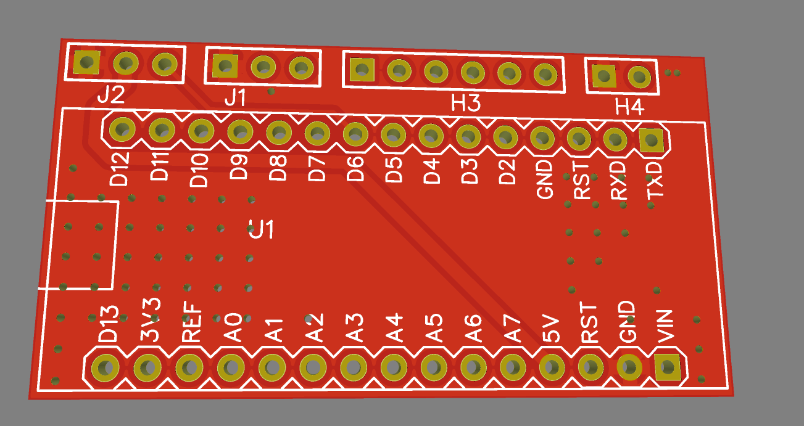

# PCB Design — Dual-Mode F1 RC Car

**Designed by Zarraf Alam Fahmid in collaboration with the Schoolcraft Engineering Club.**

This directory documents my Arduino Nano interface PCB for the club's dual-mode F1-style vehicle. The vehicle, firmware, mechanical work, integration, and testing were a team effort.

## Design summary

| Item | Specification / design detail |
|---|---|
| CAD tool | EasyEDA |
| Board | Two-layer FR-4 |
| Dimensions | 44.58 × 23.62 mm |
| Copper | 1 oz specified |
| Selected power traces | 35 mil specified |
| Interfaces | Arduino Nano, ESC control, steering servo, six IR channels, IR power |
| Grounding | GND-connected stitching vias between copper pours |
| Controller connection | Removable 2.54 mm female-header arrangement |

My work included schematic capture, component placement, routing, and manufacturing preparation. The ground vias connect the copper pours for ground continuity and heat spreading; measured temperature or performance improvements were not recorded.

## Schematic

## PCB routing

## Copper pours and stitching vias

## Assembly and board previews

## Hardware and firmware revision check

The supplied schematic and archived integrated driving sketch have three pin differences:

| Signal | PCB schematic | Driving sketch |
|---|---|---|
| ESC signal | D6 | A4 |
| Left IR 1 | A4 | A5 |
| Left IR 2 | A5 | A6 |
| Left IR 3 | A7 | A7 |
| Right IR 1 / 2 / 3 | A3 / A2 / A1 | A3 / A2 / A1 |
| Steering servo | A0 | A0 |

Reconcile the schematic, physical wiring, and firmware before using this design. These images document the supplied PCB revision, not a verified pin-for-pin match to the archived sketch. Pixy2 wiring is not shown in this schematic.

## Files and source

The PNGs are the original design screenshots supplied by the PCB designer. They replace the older circuit drawings previously in this directory. Native editable EasyEDA files and Gerbers are not included.

[Full engineering report](../F1_RC_Car_Engineering_Report.pdf) · [Vehicle overview and firmware](../README.md)
